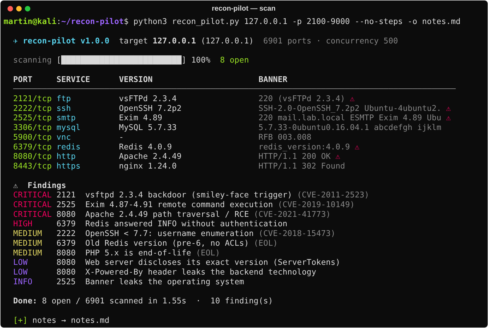
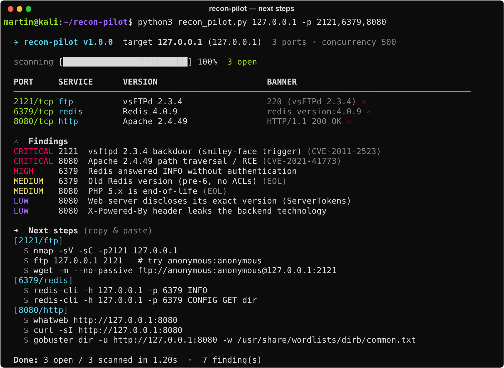
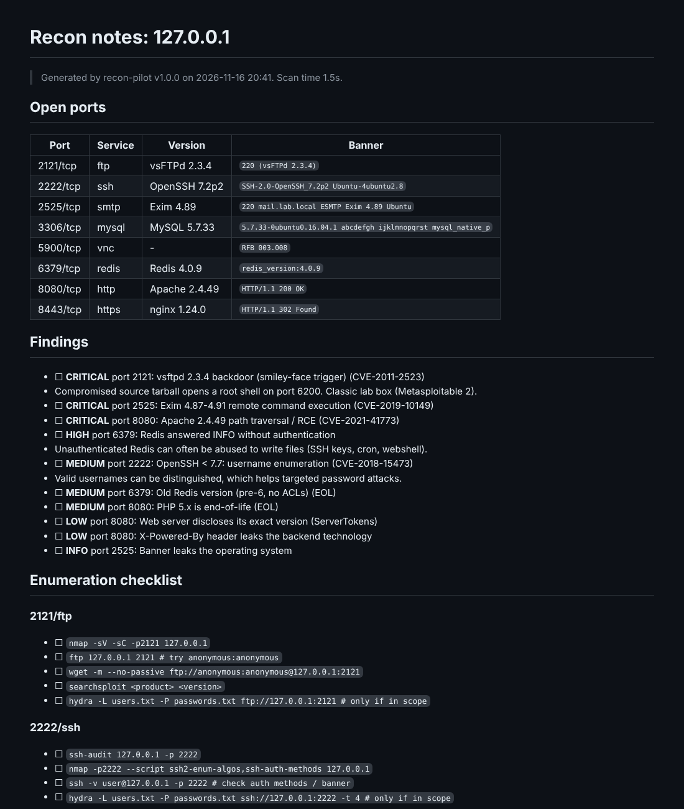

<div align="center">

# ✈️ recon-pilot

**An eJPT-style recon co-pilot: async port scan → banner grab → vulnerable version alerts → copy-paste next steps → pentest notes.**




</div>
> 🎥 **[Watch the demo video →](docs/demo.mp4)** (download to play)


---

## 📖 Why?

During the **eJPT** exam I learned that recon isn't about running one scan. It's a **loop**:
scan → identify versions → look up known issues → decide what to enumerate next → **write it all down**.

recon-pilot automates the boring parts of that loop so you can focus on thinking:

1. ⚡ **Async TCP connect scan.** It scans thousands of ports in a couple of seconds and needs no root.
2. 🏷️ **Banner grabbing + fingerprinting.** FTP, SSH, SMTP, HTTP(S), MySQL, Redis, VNC, POP3/IMAP...
3. 🚨 **Offline knowledge base.** It flags famous vulnerable versions (vsftpd 2.3.4, Apache 2.4.49, Exim 4.87–4.91, ProFTPD 1.3.5...) and misconfigurations (open Redis, Telnet, version leaks).
4. ➜ **Next steps.** You get a prioritised, copy-paste enumeration checklist per service (nmap NSE, gobuster, enum4linux, ssh-audit...).
5. 📝 **Pentest notes.** It writes a Markdown report with checkboxes and tables for credentials and notes, ready for Obsidian or CherryTree.

> ⚖️ **Scope guard:** public IPs are refused unless you pass `--authorized`. Only scan systems you
> own or have written permission to test.

## 📸 Screenshots

<table>
<tr><td width="50%"><b>Next steps for each service</b><br></td>
<td width="50%"><b>Generated notes.md</b><br></td></tr>
</table>

**Scope guard in action**


---

## 🚀 Tutorial

### 1. Install

```bash
git clone https://github.com/Martun1/recon-pilot.git
cd recon-pilot
python3 recon_pilot.py --help     # Python 3.10+, no pip install needed
```

### 2. Start the built-in practice lab (safe, local)

The lab starts **fake services with realistic banners** on `127.0.0.1`. Nothing is actually
vulnerable: each listener only sends a banner and closes the connection.

```bash
python3 lab/practice_lab.py
```

```
  [lab] FTP    listening on 127.0.0.1:2121
  [lab] SSH    listening on 127.0.0.1:2222
  [lab] SMTP   listening on 127.0.0.1:2525
  ...
```

### 3. Scan it

Open a second terminal:

```bash
python3 recon_pilot.py 127.0.0.1 -p 2100-9000
```

You should see 8 open ports and 10 findings, including **3 CRITICAL** ones. Challenge: before
reading the findings, try to guess which versions are vulnerable just from the banners.

### 4. Save your notes

```bash
python3 recon_pilot.py 127.0.0.1 -p 2100-9000 -o notes.md --json results.json
```

Open `notes.md` in Obsidian or VS Code, or push it to a private repo. Tick the checklist items as you
work through them.

### 5. Real targets (with permission)

```bash
# Your own lab VM (Metasploitable 2, a TryHackMe/HTB machine over VPN, ...)
python3 recon_pilot.py 10.10.10.5 -p all -c 1000 -o box1.md

# scanme.nmap.org is explicitly allowed to be scanned by the Nmap project
python3 recon_pilot.py scanme.nmap.org --authorized
```

| Option | Meaning |
|---|---|
| `-p top` / `all` / `1-1024` / `22,80,443` | port selection (default: 41 common ports) |
| `-c 500` | concurrent connections |
| `-t 1.0` | connect timeout (seconds); raise it for slow VPN links |
| `-o notes.md` | Markdown notes |
| `--json out.json` | machine-readable output |
| `--no-steps` | hide the next-steps checklist |
| `--authorized` | confirm permission for public IPs |

### 6. Next step: verify with Nmap

recon-pilot is a **fast first pass**, not a replacement for Nmap. Take the open ports and run:

```bash
nmap -sV -sC -p 2121,2222,2525 127.0.0.1
```

---

## 🧠 How it works

```
           ┌──────────────┐   open?   ┌──────────────┐  banner  ┌────────────────┐
 ports ──▶ │ asyncio pool │ ────────▶ │ banner grab  │ ───────▶ │ fingerprint    │
           │ (semaphore)  │           │ + HTTP/Redis │          │ regex signatures│
           └──────────────┘           │   probes     │          └───────┬────────┘
                                      └──────────────┘                  │
                     ┌──────────────────────────┬───────────────────────┤
                     ▼                          ▼                       ▼
            knowledge_base.json:       next steps per service    notes.md / JSON
            vulnerable versions +      (copy-paste commands)
            misconfig hints
```

- **Concurrency:** an `asyncio.Semaphore` caps open sockets (`-c`), so you don't exhaust file descriptors.
- **Server-first vs client-first:** FTP/SSH/SMTP talk first, so the tool waits 1.2 s for a banner.
  Otherwise it sends an HTTP `HEAD` (or Redis `INFO` on 6379) to make the service respond.
- **Knowledge base:** a plain JSON file of regex rules. It's easy to read, review and extend.

### Add your own vulnerability rule

```json
{"match": "openssh 9\\.[0-7]p", "severity": "HIGH", "title": "OpenSSH regreSSHion", "ref": "CVE-2024-6387"}
```

## 🧪 Tests

```bash
python3 -m unittest discover -s tests -v
```

The CI pipeline also starts the practice lab and runs a full end-to-end scan on every push.

## 🗺️ Roadmap

- [ ] UDP probes (DNS, SNMP, TFTP)
- [ ] TLS certificate parsing (CN/SAN → find hostnames for vhost enumeration)
- [ ] Host discovery for whole subnets (`10.0.0.0/24`)
- [ ] Import Nmap XML to reuse the notes generator

## ⚖️ Legal

Unauthorised port scanning can be illegal. This tool is for education, CTFs, your own lab, and
engagements with written permission. The author is not responsible for misuse.

---

<div align="center">
Made by <a href="https://github.com/Martun1">Martin Ivanov</a> · eJPT · CCNA · Computer Science @ NBU
</div>
